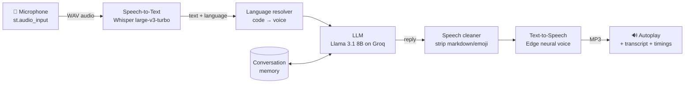

# 🎙️ Voice AI Assistant

> Speak a question and hear the answer in a natural voice. A complete **speech-to-text → LLM → text-to-speech** pipeline that works in **11 languages**, including Hindi, Marathi and Kannada.


[](https://github.com/ashwinibiradar2711/voice-ai-assistant/actions)


---

## 🎯 What it does

1. 🎤 You **speak** into the browser microphone (or type).
2. 📝 **Whisper** converts your speech to text and **detects the language**.
3. 🧠 **Llama 3.1** writes a short, spoken-style answer **in the same language**.
4. 🔊 A **neural voice** reads the answer aloud, and it autoplays in the browser.

Ask in Marathi and it answers in Marathi, with a Marathi voice.

## ✨ Features

- 🌍 **Multilingual:** automatic language detection with matching voices for English, Hindi, Marathi, Kannada, Tamil, Telugu, Gujarati, Bengali, Spanish, French and German
- ⚡ **Low latency:** Whisper large-v3-turbo and Llama 3.1 both run on Groq's LPU hardware
- 💬 **Conversation memory:** follow-up questions work ("and what about tomorrow?")
- 🗣️ **Voice-optimised replies:** the prompt asks for short spoken sentences, and a cleaner strips markdown, links and emojis so the voice never reads "asterisk asterisk"
- ⏱️ **Latency metrics:** every reply shows the time taken by speech-to-text, the LLM and text-to-speech
- 🔌 **Swappable components:** cloud or **fully offline** mode (faster-whisper + pyttsx3), with any OpenAI-compatible LLM
- ✅ **Tested:** 30 unit tests using fake components, so no models or internet are needed in CI

## 🏗️ Architecture



The `VoiceAssistant` class receives the three components through **dependency injection**, so each can be swapped (cloud ↔ offline) or replaced with a fake in tests.

## 🧠 Models

| Stage | Default model | Where it runs | Offline alternative |
|---|---|---|---|
| Speech-to-text | **Whisper large-v3-turbo** (OpenAI) | Groq Cloud API | faster-whisper `base` (int8, CPU) |
| Language model | **Llama 3.1 8B Instant** (Meta) | Groq Cloud API | Ollama `llama3.1` |
| Text-to-speech | **Microsoft neural voices** (e.g. `mr-IN-AarohiNeural`) | edge-tts (free) | pyttsx3 (OS voices) |

## 🛠️ Tech Stack

| Layer | Technology |
|---|---|
| UI | Streamlit (`st.audio_input`, chat UI, autoplay audio) |
| Speech-to-text | Whisper via Groq API / faster-whisper |
| LLM | Llama 3.1 via the OpenAI-compatible Python SDK |
| Text-to-speech | edge-tts (async streaming) / pyttsx3 |
| Testing / CI | pytest, ruff, GitHub Actions |
| Deployment | Docker |

## 📂 Project Structure

```
voice-ai-assistant/
├── app.py                    # Streamlit voice chat UI
├── voice_assistant/
│   ├── config.py             # Settings from .env
│   ├── stt.py                # Whisper (Groq) + faster-whisper (local)
│   ├── llm.py                # Voice-friendly prompt + chat model
│   ├── tts.py                # Edge neural voices + offline pyttsx3
│   ├── languages.py          # Language detection → voice mapping
│   ├── text_utils.py         # Clean text for natural speech
│   └── assistant.py          # STT → LLM → TTS pipeline with timings
├── tests/                    # 30 unit tests (with fake components)
├── .github/workflows/ci.yml
├── Dockerfile
├── requirements.txt          # cloud mode
├── requirements-offline.txt  # + offline speech
└── .env.example
```

## 🚀 Quick Start

```bash
git clone https://github.com/ashwinibiradar2711/voice-ai-assistant.git
cd voice-ai-assistant

python -m venv .venv
.venv\Scripts\Activate.ps1        # Windows  (Linux/Mac: source .venv/bin/activate)

pip install -r requirements.txt
copy .env.example .env            # Linux/Mac: cp .env.example .env
# open .env and paste your free Groq key into API_KEY

streamlit run app.py
```

Open http://localhost:8501, allow microphone access, tap the 🎤 and ask:

- *"What is machine learning? Explain simply."*
- *"मला पुण्यात फिरण्यासाठी तीन ठिकाणे सांगा"* (Marathi)
- *"Give me a quick tip to improve my sleep."* Then follow up with *"Why does that work?"*

### Fully offline mode

```bash
pip install -r requirements-offline.txt
# in .env:
# STT_PROVIDER=local
# TTS_PROVIDER=offline
# API_BASE_URL=http://localhost:11434/v1   (Ollama)
# LLM_MODEL=llama3.1
```

### Docker

```bash
docker build -t voice-assistant .
docker run -p 8501:8501 --env-file .env voice-assistant
```

## 🧪 Tests

```bash
pip install -r requirements-dev.txt
pytest -v
```

The pipeline tests use **fake STT, LLM and TTS components**, so they check the orchestration logic (language routing, memory, timings, error handling) instantly, without calling any API.

## 💡 Design Decisions

- **Cascaded pipeline (STT → LLM → TTS)** instead of one speech-to-speech model: each stage can be inspected, measured, tested and swapped independently.
- **Groq for both STT and LLM:** one free API key, and very low latency on LPU hardware.
- **Speech-first prompting:** voice answers must be short and contain no markdown, so the system prompt and a text cleaner enforce this.
- **Language-matched voices:** Whisper's detected language selects both the reply language and the TTS voice.
- **Dependency injection:** components are passed into `VoiceAssistant`, which makes offline mode and fake-based testing simple.

## 🗺️ Roadmap

- [ ] Streaming: speak the first sentence while the rest is still generating
- [ ] Wake word ("Hey Assistant") with continuous listening
- [ ] Tool calling: weather, time and web search
- [ ] Voice cloning / custom voice selection in the UI
- [ ] Deploy to Hugging Face Spaces

## 👩‍💻 Author

**Ashwini Biradar**, Software Engineer (GenAI / LLM)

[](https://github.com/ashwinibiradar2711)
[](https://in.linkedin.com/in/ashwini-biradar-57b505251)

If you like this project, please ⭐ the repo!

## 📄 License

MIT, see [LICENSE](LICENSE).
